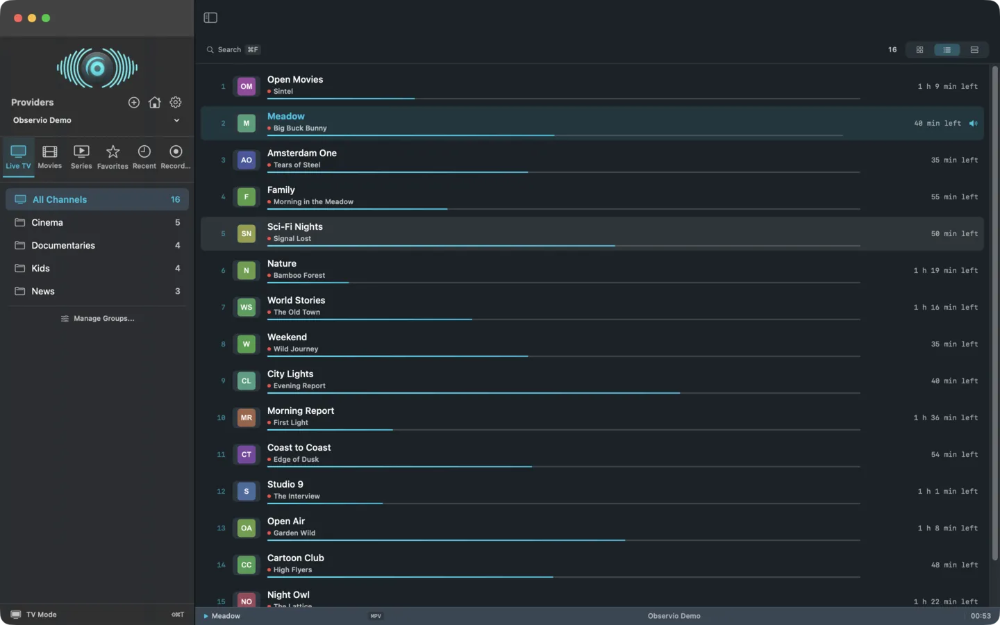
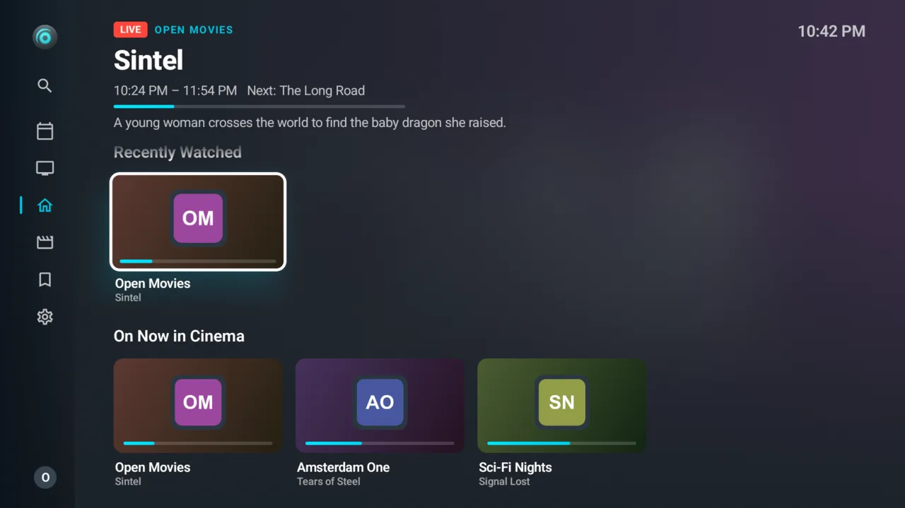
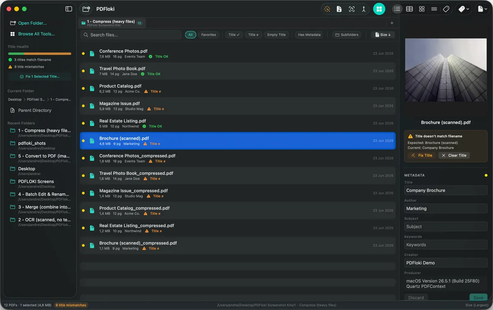
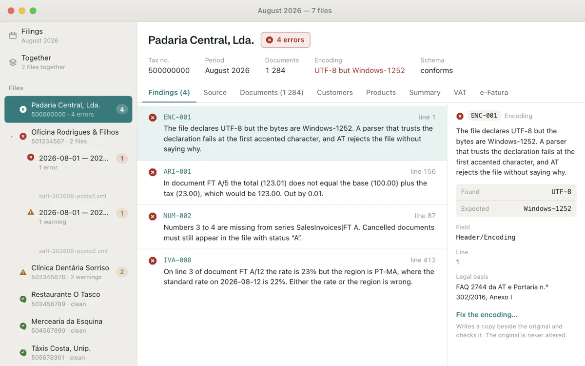
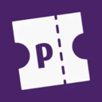

### Hi, I’m Andrei

Indie developer in Portugal, shipping as **[Hexadexa](https://hexadexa.io)**.
I build native macOS and iOS apps, Android apps, web platforms and automation tools.
The apps run without accounts, telemetry, or anything in the middle.

Before code there were 15+ years in audio and video: live events, sound design,
post-production, with IT running alongside the whole time. Most of what I make starts as
something I need myself, then grows into something others might find useful too.

---

### Apps

<table>
<tr>
<td width="50%" valign="top">

<b><a href="https://observio.hexadexa.io">Observio</a></b> 
Mac · iPhone · iPad · Android · Android TV · Fire TV 
Live TV and media player for your own IPTV playlists and Plex, Emby and Jellyfin libraries.
<a href="https://github.com/h3x4d3x4/Observio-Releases">Mac downloads</a> ·
<a href="https://github.com/h3x4d3x4/Observio-Android-Releases">Android downloads</a>
</td>
<td width="50%" valign="top">

<b><a href="https://bosun.hexadexa.io">Bosun</a></b> 
iPhone · iPad · Apple Watch · Android beta 
Control panel for TrueNAS SCALE and Unraid servers: pools, apps, VMs, shares and users,
made for touch. Free on the App Store.
</td>
</tr>
<tr>
<td valign="top">

<b><a href="https://pdfloki.app">PDFloki</a></b> 
macOS 
PDF toolkit for a whole library: compression, OCR, batch rename, metadata, merge and split,
all on your Mac.
<a href="https://github.com/h3x4d3x4/pdfloki-releases">Downloads</a>
</td>
<td valign="top">

<b><a href="https://crivo.hexadexa.io">Crivo</a></b> 
macOS 
Validates Portuguese SAF-T tax files before they're filed: 54 rules, each finding with its
line and legal basis.
</td>
</tr>
<tr>
<td valign="top">

<b><a href="https://gridpush.hexadexa.io">GridPush</a></b> 
macOS 
Redesign your iPhone's home screen from your Mac: rearrange icons, build folders, sort apps.
</td>
<td valign="top">

<b><a href="https://github.com/h3x4d3x4/LidBoot">LidBoot</a></b> 
macOS · open source 
Stops a MacBook starting up when you open the lid or plug in power.
<code>brew install --cask h3x4d3x4/tap/lidboot</code>
</td>
</tr>
<tr>
<td valign="top">

<b><a href="https://tidegrab.hexadexa.io">TideGrab</a></b> 
macOS · beta 
Saves video and audio from about 1,800 sites, or catches what a page plays: playlists,
channels and live streams, without re-encoding.
<a href="https://github.com/h3x4d3x4/TideGrab-Releases">Downloads</a>
</td>
<td valign="top">

<b><a href="https://assay.hexadexa.io">Assay</a></b> 
Web 
Ad blocker test that only reports what it can prove, cross-checking every probe against its
own server and nameserver.
</td>
</tr>
</table>

### Open source

 **[Pretix Event Analytics](https://github.com/h3x4d3x4/Pretix-Event-Analytics)** (Python) ·
Analytics for the [Pretix](https://pretix.eu) ticketing platform: sales against previous editions,
first-timers and returning people, audience and check-in, without storing personal data.
Running in production at a music festival. `pip install pretix-event-analytics`

 **[PulseGrab](https://github.com/h3x4d3x4/PulseGrab)** (JavaScript) ·
Userscript that adds a download manager to Emby, Plex and Jellyfin servers.
On [Greasy Fork](https://greasyfork.org/en/scripts/573086-pulsegrab-universal-download-manager).

 **[LidBoot](https://github.com/h3x4d3x4/LidBoot)** (Swift) ·
The whole app, source included.

### Also

Websites and platforms for clients in Portugal: a music festival, a sound-equipment rental
company and a tech repair clinic, plus WhatsApp bots that run crew chats.
Everything is on **[hexadexa.io](https://hexadexa.io/projects)**.

---

Swift · SwiftUI · Kotlin · Python · JavaScript · Next.js · Docker 
[hexadexa.io](https://hexadexa.io) · [About me](https://hexadexa.io/about) · [Contact](https://hexadexa.io/contact)
